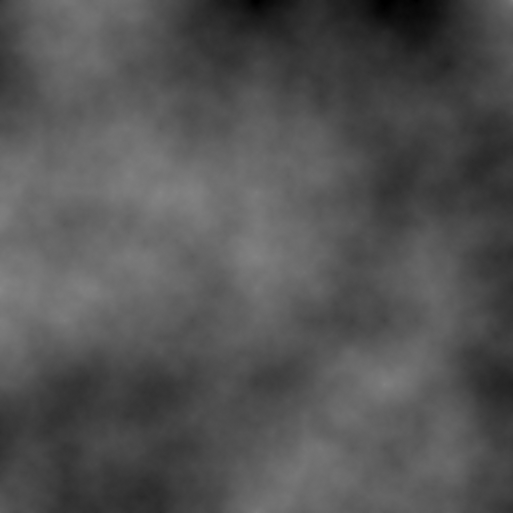
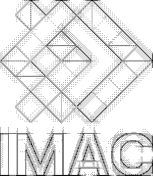
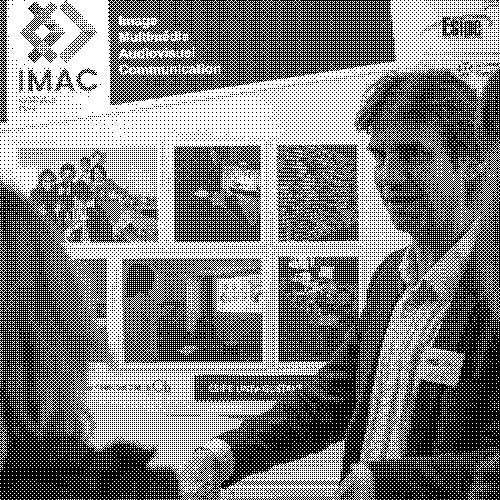

# 🐣 S1 | Prog: Workshop

#### Thomas Eugène

## Sommaire

1 - Structure du projet
2 - Presentation d'algorithmes
2.1 - Diamond square
2.2 - Convolutions
2.3 - Tramage
3 - Sources

## 1 - Structure du projet

Mon projet est organisé de la manière suivante :

- Le main dans `src/main.cpp` qui contient le code principal du programme, il centralise tous les appels vers le namespace "effet".
- Le namespace "effet" dans `src/effet/...` qui contient tous les algorithmes de traitement d'image sous forme d'un fichier par effet.

L'objectif était de créer un programme complet qui permet de faire toutes les opérations possibles en passant par differrents menus. Le programme est capable de charger une image, d'appliquer un effet et de sauvegarder le résultat.

## 2 - Presentation d'algorithmes

### 2.1 - Diamond square

Mon algorithme de génération de terrain est basé sur l'algorithme Diamond-Square. Il permet de générer des terrains réalistes en utilisant une approche récursive. L'algorithme commence avec un carré initial et divise ce carré en quatre sous-carrés, en ajustant les valeurs des coins et du centre pour créer des variations de hauteur. Ce processus est répété plusieurs fois pour obtenir un terrain détaillé.

La difficulté résitde dans le choix des coordonnées qui s'ajustenet correctement en passant dans les boucles "for".

### 2.2 - Convolutions

Les convolutions sont une technique de traitement d'image qui consiste à appliquer un filtre (ou noyau) sur chaque pixel de l'image pour produire un effet spécifique. Dans mon projet, j'ai implémenté plusieurs types de convolutions, tels que le flou, l'embossage, le contouring et le sharpening.

J'ai eu du mal à comprendre le fonctionnement du filtre séparable pour flouter, au final j'ai réussi à l'implémenter ce qui permet de réduire la complexité de l'opération.

_Note : J'ai ajouté après l'effet de Outline un tramage pour rendre l'image en noir et blanc plutot qu'une transformation de base avec un seuil_

### 2.3 - Tramage

Le tramage est une technique utilisée pour simuler des niveaux de gris dans les images en utilisant uniquement des pixels noirs et blancs. Dans mon projet, j'ai implémenté un algorithme de tramage basé sur la méthode de Bayer. Cette méthode utilise une matrice de Bayer pour déterminer quels pixels doivent être noirs et quels pixels doivent être blancs, créant ainsi l'illusion de nuances de gris.

## 3 - Sources

- [Diamond square](https://fr.wikipedia.org/wiki/Algorithme_Diamant-Carr%C3%A9)
